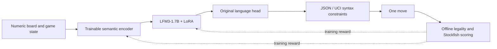

# LFM3 Chess Lab

**Reward-only chess post-training, built and measured on a 16 GB MacBook Air.**

An experimental LFM3-1.7B runtime and reinforcement-learning pipeline for Apple
silicon. The research question is whether a small language model can learn
board-conditioned move selection from verifiable rewards while preserving its
original language head.

**Research in progress · MLX · Apple M4 · No model weights included**

The implementation, dataset construction, baseline evaluation, and recovery
checks are complete. The large post-training comparison is **pending**. This is
a research system, not a demonstrated strong chess player.

## At a glance

| Component | What was built or measured |
| :--- | :--- |
| Runtime | Local LFM3 implementation in MLX, including gated convolutions, full/sliding attention, caches and structured generation |
| Trainable policy | Numeric board encoder + rank-8 LoRA on the final 16 layers; original language head |
| Corpus | 2,000,000 training / 50,000 development / 100,000 sealed test positions |
| Split audit | Zero board-state or game-trajectory overlap across splits |
| Gradient benchmark | 11.983 s → 3.938 s with shared-prefix scoring: **3.04×** in the measured workload |
| Recovery | Interrupted/resumed rollouts, adapter tensors and Adam state reproduced exactly in a diagnostic fixture |
| Latest saved state | November 2, 2026: paused at overall training position 3,705; post-training evaluation pending |

The corpus contains two million available training positions; the run has **not**
trained on all of them. Timing describes a particular gradient-computation
benchmark, not total training throughput. [Evidence and limitations →](docs/RESULTS.md)

## From board state to a rewarded move



The semantic encoder turns piece, color, square and game-state tensors into 262
embedding slots. Board state bypasses text tokenization. Both sides share one
policy; side to move is an explicit input.

Training uses eight sampled responses per position, leave-one-out base
advantages, a separate exact-match bonus and a clipped policy-gradient surrogate.
The corrected objective retains a negative advantage for illegal responses even
when all eight samples repeat the same mistake. Entropy and uniform-to-policy KL
regularization support exploration. Exact-match gradients retain at least 80%
of the sum of component norms before Adam. Step guards bound parameter RMS and
sampled sequence probability changes. [Method →](docs/METHOD.md)

Stockfish is an offline reward/evaluation oracle. Generation receives no engine
recommendation, legal-move list, legality mask, retry or repaired move. JSON/UCI
constraints enforce notation only; an illegal chess move can still be emitted.

## Evaluation that separates format from capability

The completed initial-model baseline uses the semantic encoder and one greedy
attempt on each of 50,000 development positions:

| Measurement | Count | Rate |
| :--- | ---: | ---: |
| Valid JSON/UCI format | 50,000 | 100.000% |
| Legal chess move | 3,372 | 6.744% |
| Exact fixed-configuration Stockfish match | 236 | 0.472% |

These are **baseline** results. They show that formatting success alone does not
establish chess capability. No broad post-training improvement or Elo rating is
claimed. The test split remains sealed during recipe selection.

## Explore the code

| Location | Purpose |
| :--- | :--- |
| [`mlx_lm/models/lfm3.py`](mlx_lm/models/lfm3.py) | LFM3 architecture, weight conversion, caches and differentiable attention |
| [`mlx_lm/structured.py`](mlx_lm/structured.py) | JSON-schema token support shared by sampling and likelihood calculations |
| [`experiments/chess/`](experiments/chess/) | Current encoder, reward, training, corpus and evaluation code |
| [`experiments/shared_prefix_v1/`](experiments/shared_prefix_v1/) | Frozen helper sources matching the reported gradient benchmark |
| [`examples/`](examples/) | Runtime/reference and structured-output validation programs |
| [`evidence/`](evidence/) | Compact historical summaries and source hashes; no raw examples or checkpoints |

The surrounding `mlx_lm` package is retained from upstream to make this a coherent
editable runtime. The project-specific additions are the LFM3 model, structured
output support and chess experiments. Upstream authorship and license notices
are preserved.

## Reproduce a new experiment

Use a dedicated environment on Apple silicon. The observed setup was Python
3.12.13, MLX 0.32.4 and a 16 GB M4 MacBook Air.

```bash
python3.12 -m venv .venv
source .venv/bin/activate
python -m pip install -r requirements-local.txt
```

The requirements file records the observed environment. Model downloads, corpus
construction, oracle labeling and training are explicit separate steps; none
runs at installation. See the [reproduction guide](docs/REPRODUCING.md) for the
pinned model, dataset recipe, fresh baseline, training and paired comparison.

The historical corpus, checkpoints and raw evaluation records are deliberately
not bundled. A rebuilt corpus is a new experiment and is not promised to match
the historical corpus byte for byte. The reported training continuation also
depends on a retained local checkpoint that is not distributed here.

## Attribution

Built on [MLX LM](https://github.com/ml-explore/mlx-lm) at commit
`736ab0d8c1d0edc79c3d798044fe6904e2fa23be`, using
[Liquid AI's LFM3-1.7B](https://huggingface.co/LiquidAI/LFM3-1.7B),
[Lichess game archives](https://database.lichess.org/),
[Stockfish](https://stockfishchess.org/),
[python-chess](https://python-chess.readthedocs.io/) and
[Outlines Core](https://github.com/dottxt-ai/outlines-core).

See [LICENSE](LICENSE), [ACKNOWLEDGMENTS.md](ACKNOWLEDGMENTS.md) and
[third-party notices](THIRD_PARTY_NOTICES.md). This is an independent experimental
code snapshot; it is not an upstream MLX LM release or an official Liquid AI project.
